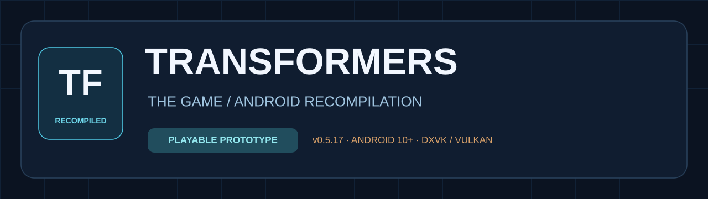
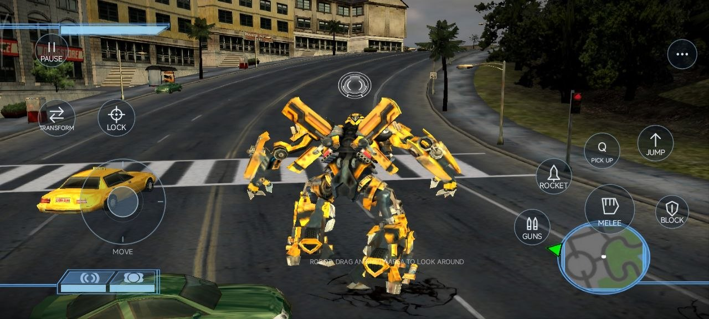
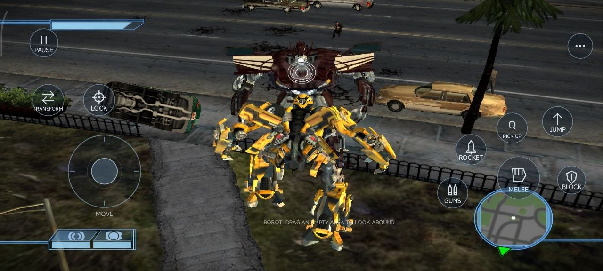
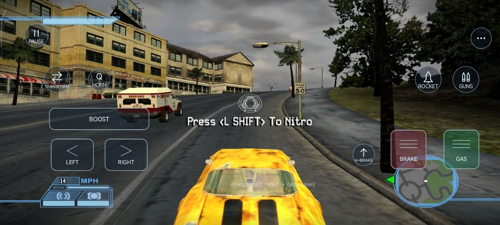
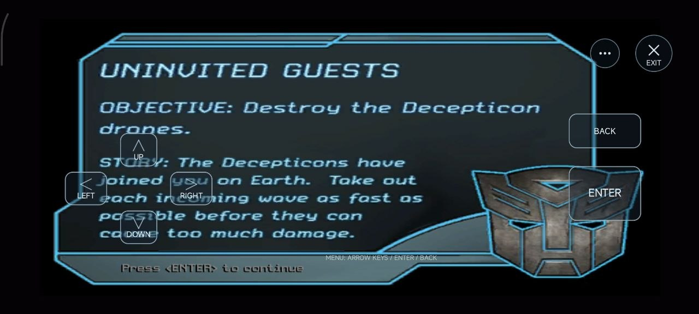
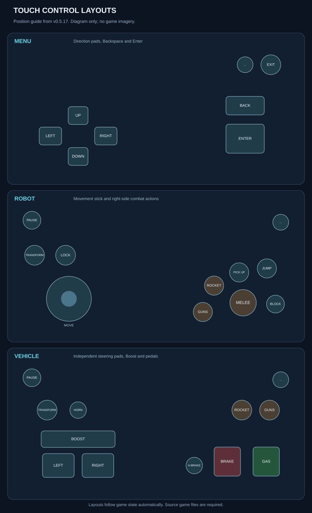

### A playable Android recompilation prototype

[Download](#android-downloads) · [Install](docs/INSTALLATION.md) · [Controls](docs/CONTROLS.md) · [Status](docs/STATUS.md) · [Changelog](CHANGELOG.md)

An experimental Android port of the PC version of **Transformers: The Game**.
Static x86 recompilation supplies native game code; a Windows API compatibility
layer, DXVK Native/Vulkan, and AAudio provide the Android runtime.

## Android downloads

**[v0.5.17 — playable preview](https://github.com/sindufha/transformers-the-game-recomp/releases/tag/v0.5.17)** · October 24, 2026

| APK | Size | Use |
| --- | --- | --- |
| [ARM64](https://github.com/sindufha/transformers-the-game-recomp/releases/download/v0.5.17/Transformers-The-Game-Recompiled-v0.5.17-arm64-v8a.apk) | 35.1 MiB | Recommended for compatible 64-bit Android devices; physically tested ABI. |
| [ARMv7](https://github.com/sindufha/transformers-the-game-recomp/releases/download/v0.5.17/Transformers-The-Game-Recompiled-v0.5.17-armeabi-v7a.apk) | 59.6 MiB | Requires 32-bit app support; built and package-verified, not device-tested. |
| [Universal](https://github.com/sindufha/transformers-the-game-recomp/releases/download/v0.5.17/Transformers-The-Game-Recompiled-v0.5.17-universal.apk) | 153.9 MiB | Contains ARM64, ARMv7, x86, and x86_64; only ARM64 physically tested. |

[SHA-256 checksums](https://github.com/sindufha/transformers-the-game-recomp/releases/download/v0.5.17/SHA256SUMS.txt) · [Build information](https://github.com/sindufha/transformers-the-game-recomp/releases/download/v0.5.17/BUILD_INFO.json) · [Third-party notices](https://github.com/sindufha/transformers-the-game-recomp/releases/download/v0.5.17/THIRD_PARTY_NOTICES.txt)

Choose one APK. All packages use the same application ID and development signing
certificate. These are **experimental development prereleases**, not a claim of
complete campaign compatibility.

**Your own compatible PC game files are required.** The APKs contain the native
runtime and a precompiled shader cache, but no original PC executable, DAT
archives, WAV assets, or Bink movies. Private signing keys are not distributed.
This repository publishes APK previews and documentation; source code is not
currently published.

## Features

- **Native rendering:** Direct3D 9 calls reach DXVK Native and Vulkan.
- **Original gameplay audio:** DirectSound music, dialogue, and effects reach AAudio.
- **Robot controls:** circular movement stick, camera drag, Guns, Rocket, Melee,
  Block, Lock, Jump, Pick Up, and a single Transform action.
- **Vehicle controls:** independent steering pads, Gas/Brake pedals, Boost, and Handbrake.
- **Automatic layouts:** menus, robot form, vehicle form, and mission prompts
  select the appropriate overlay. All control labels are in English.
- **Launcher graphics settings:** resolution, High Res Texture, Bloom, Shadows,
  and Motion Blur.
- **Fullscreen and resume:** immersive system bars and retained background
  sessions, with paused rendering/audio/timers and a return notification.
- **343 cached shader requests:** includes 14 additions from Decepticon Chapter 1 testing.

## Screenshots

<table>
  <tr>
    <td align="center">
       
      Robot gameplay
    </td>
    <td align="center">
       
      Robot combat
    </td>
  </tr>
  <tr>
    <td align="center">
       
      Vehicle gameplay
    </td>
    <td align="center">
       
      Mission menu
    </td>
  </tr>
</table>

*Android gameplay screenshots. Click an image to view it at full size.*

## Current results

| Area | Observed result |
| --- | --- |
| Autobot campaign | The Suburbs reached playable 3D gameplay. |
| Decepticon campaign | Chapter 1 loading and gameplay confirmed by the tester. |
| Input | Movement, camera, weapons, transformation, vehicle pads, and mission prompts implemented. |
| Background resume | Native surface recovery and continued rendering observed in the same process. |
| Latest control fix | Large menu BACK sends **Backspace**; 19 touch replay tests passed. |

Physical testing has used a **POCO F3 / M2012K11AG, Android 13, Adreno 650**.
Frame rate varies with scene complexity and device conditions. A constant frame
rate and complete campaign compatibility are not guaranteed.

## Controls

See [all control bindings](docs/CONTROLS.md).

View the control layout guide

  

*Schematic exported from the touch-control model. Click to view at full size.*

## Requirements

- Android 10 or newer and a compatible Vulkan-capable device.
- The supported PC executable and full game folder. Imported data occupies
  approximately 4.35 GB, in addition to the APK and native-library installation.
- Sufficient extra storage if the source game folder is also kept on the device.

Install the APK, select your executable, import your game folder, choose graphics
settings, and start the game. The launcher verifies file sizes and hashes before
using its private imported copy. See the [installation guide](docs/INSTALLATION.md)
for executable identification and updating an existing installation.

## Known limits

Bink/FMV playback and Android-side HLSL compilation are unavailable. Additional
levels or graphics combinations may require shader requests not yet collected.
The full campaigns, dedicated aircraft controls, and non-ARM64 devices remain
partially or entirely unvalidated. See [status](docs/STATUS.md) and
[troubleshooting](docs/TROUBLESHOOTING.md).

## More information

- [Installation and updates](docs/INSTALLATION.md)
- [Touch controls](docs/CONTROLS.md)
- [Project status and verification](docs/STATUS.md)
- [Architecture](docs/ARCHITECTURE.md)
- [Troubleshooting and reporting an issue](docs/TROUBLESHOOTING.md)
- [Changelog](CHANGELOG.md)
- [Third-party components](docs/THIRD_PARTY.md)

## Credits

Inspired by [NFSU2 Recompiled](https://github.com/codepdbh/nfsu2-recompiled),
particularly its recompilation workflow and Android control approach.
Development uses [pcrecomp](https://github.com/sp00nznet/pcrecomp),
[DXVK Native](https://github.com/Joshua-Ashton/dxvk-native),
[libadrenotools](https://github.com/bylaws/libadrenotools), Mesa/Turnip, and
SPIRV-Tools. Their notices are included in the APK and release assets.
This is an independent project, not an official Transformers release.
