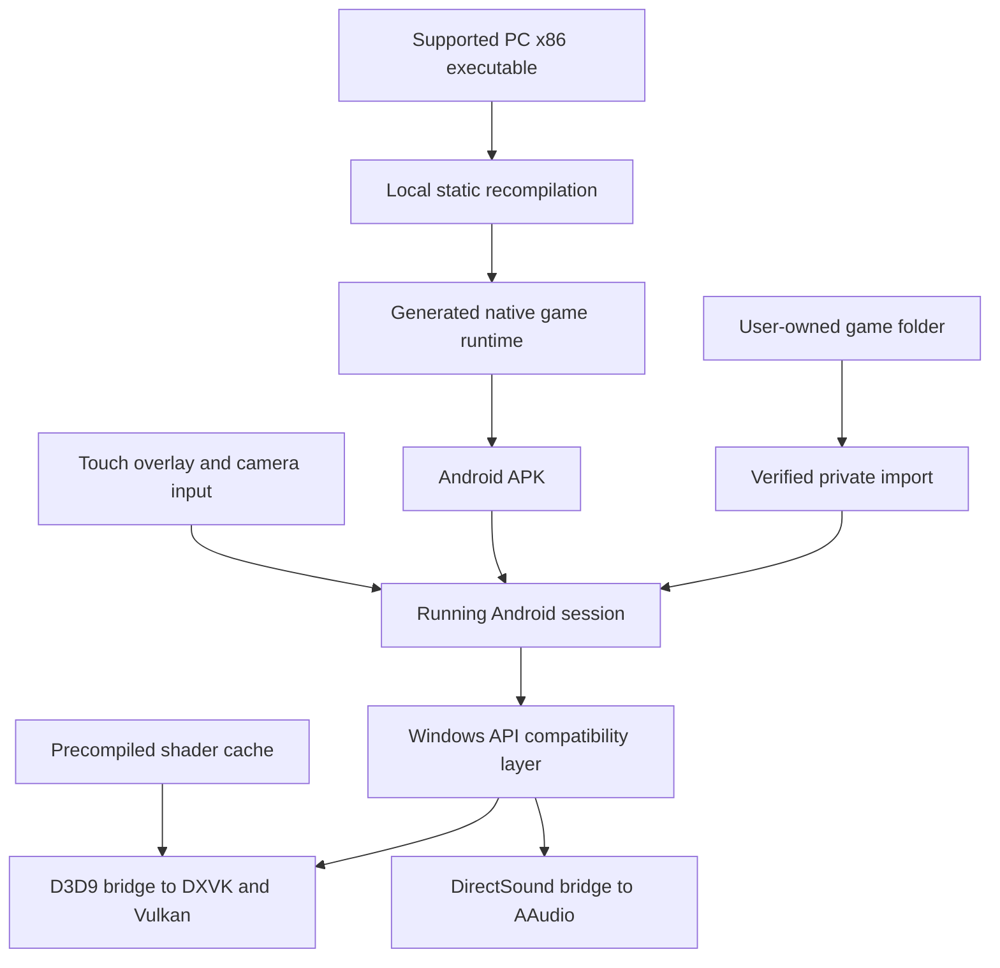

# Architecture

The project translates the supported PC executable into native Android code
during development. The Android app also needs the user's executable as data
and the original game assets at runtime.

## Main parts

| Layer | Role |
| --- | --- |
| Launcher/importer | Checks the supported EXE and expected game files, stores the imported copy privately, and applies graphics settings. |
| Native runtime | Executes generated code with the project's guest memory, Windows API, threading, input, and resource interfaces. |
| Graphics | Converts supported guest D3D9/D3DX calls to native DXVK interfaces and Vulkan presentation. |
| Audio | Routes original DirectSound PCM playback to AAudio. |
| Controls | Publishes a game-state profile for the Java touch overlay; input reaches the original keyboard/mouse bindings. |
| Lifecycle | Serializes native graphics with surface replacement, suspends inactive work, and preserves a live session for resume. |

## Shader handling

The release includes 343 exact captured compiler requests, matching bytecode,
and constant tables. Missing requests are a known runtime boundary: the project
does not yet include an Android HLSL compiler. The Decepticon Chapter 1 fix added
14 requests observed during that loading and gameplay test.

## What is distributed

Release APKs include the launcher, native runtime, generated game code, shader
cache, and third-party runtime components/notices. They do not include the
original Windows EXE, DAT archives, WAV assets, or Bink movies.

This repository currently distributes APK previews and documentation. Original
files, generated C, development reports, private keys, and the port source tree
are not published here. The automatic GitHub source archive therefore contains
the documentation tree, not a complete buildable source release.
